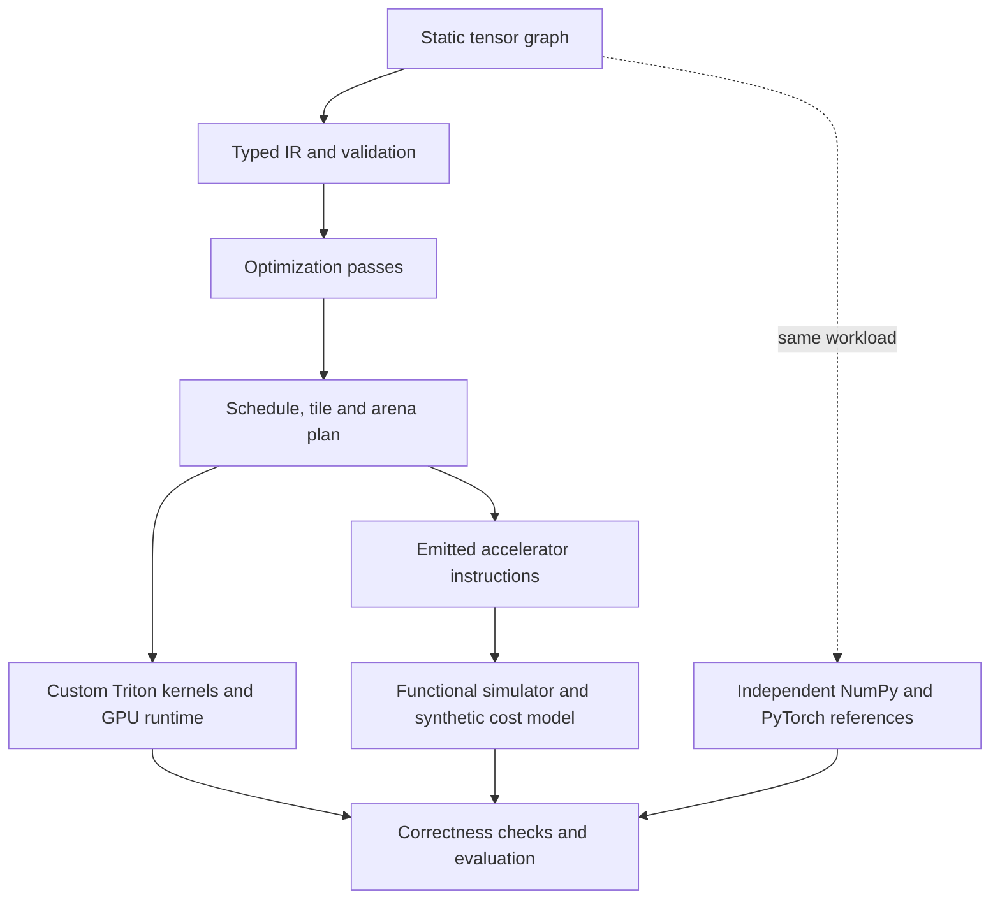

# ML Compiler & GPU Execution Platform

A **Python-based tensor compiler** that takes static MLP-style graphs through an
original typed IR, optimization passes, scheduling, tiling and buffer planning.
Execute the result through custom Triton kernels on an NVIDIA GPU or an
independently executable, resource-constrained accelerator simulator. Inspect how
compiler decisions affect correctness, memory use and measured execution time.

- **Compiler engineering:** legal fusion, dependency-aware scheduling and lifetime-based arena reuse, with before/after IR and inspectable execution plans.
- **Accelerator backend:** emitted DMA/compute instructions, banked SRAM constraints and a functional interpreter with a separate synthetic cost model.
- **GPU engineering:** original Triton kernels, precision-preserving epilogues and an integrated graph runtime, checked against NumPy/PyTorch references.



## Recorded evidence: wins and losses

The committed audit records **385 passing CPU/GPU tests, zero skipped**, on an
RTX 4060 Laptop GPU under WSL2, plus **237 CPU tests from an isolated installed
wheel**. The runtime study has **48 cases** with custom, PyTorch eager and Inductor
comparisons. These are existing reports, separate from hosted CPU CI.

| Medium workload on that RTX 4060 Laptop GPU | Custom / PyTorch eager median | What it shows |
| --- | ---: | --- |
| Fused elementwise, FP16, 128 x 384 | 1.472 / 5.264 us | Lower custom device-region median |
| Matmul, FP16, 128 x 256 @ 256 x 384 | 7.104 / 3.647 us | Vendor-backed eager matmul wins |
| MLP + residual, FP16, M=128, K=256, N=384 | 330.320 / 263.264 us | Custom optimized bound host execution loses despite 6 -> 3 launches |

The first two rows are **hot-cache, repeated fixed-input CUDA Graph device-region
medians**: they exclude JIT, ordinary host dispatch, allocation and transfers.
The MLP row is **bound, synchronized host latency** with resident GPU inputs;
custom execution borrows preallocated outputs, while eager includes its normal
output allocations. These scopes are distinct and timing variability is material.
See [current results and exact artifact fields](docs/current-results.md) for both
precisions, source commits, raw samples and limitations. Simulator cycles are synthetic estimates.
Performance was measured at `a3c34ea`; final correctness-state validation uses
`020c779`. The later change restores caller precision after measurements.

## CPU quickstart

From the repository root, with Python 3.10+. The block uses Linux/WSL activation;
on PowerShell, replace that line with `.venv\Scripts\Activate.ps1`.

```bash
python -m venv .venv
source .venv/bin/activate
python -m pip install -r requirements/cpu.lock -e .
python -m pytest -m 'not gpu'
mlgpu inspect --workload epilogue --output artifacts/local/ir.json
mlgpu demo --backend reference --workload mlp
mlgpu demo --backend simulator --workload epilogue
```

[Hosted CI](.github/workflows/ci.yml) covers CPU validation on Python 3.10, 3.12
and 3.13. CPU success and skipped GPU cases do not validate physical GPU execution.

## NVIDIA GPU quickstart: Linux or WSL2

Use a fresh Python 3.12 environment and a compatible NVIDIA driver. The measured
configuration used driver 566.36, CUDA 12.6 PyTorch wheels and Triton 3.5.1;
check driver compatibility on another machine. Native Windows Triton is outside
the supported environment. No driver or power-setting changes are required by these commands.

```bash
python3.12 -m venv .venv
source .venv/bin/activate
python -m pip install torch==2.9.1 --index-url https://download.pytorch.org/whl/cu126
python -m pip install -r requirements/gpu.lock -e .
mlgpu doctor --require-gpu
python -m pytest
```

[GPU CI](.github/workflows/gpu.yml) is manual and requires a provisioned
self-hosted CUDA runner; it is not automatic hosted GPU coverage.

## Three runnable engineering stories

1. **Compiler:** `mlgpu inspect --workload epilogue` shows typed IR, each pass,
   the dependency schedule, tile choices and arena allocations. The recorded
   [epilogue plan](artifacts/audit/demos/epilogue.json) lowers matmul, bias and GELU
   to this schedule entry (excerpt from `execution_plan.schedule[0]`):

   ```json
   {"op":"fused_matmul","inputs":["x","w","b"],"output":"y","attrs":{"activation":"gelu"}}
   ```

2. **Kernels:** `mlgpu microbenchmark --output artifacts/local/microbenchmarks.json`
   measures standalone operations/fused regions and tile choices using the documented
   capture policy. Inspect the [recorded kernel experiment](artifacts/audit/microbenchmarks.json)
   and [CUDA profile](artifacts/audit/profile.json).
3. **Integrated execution:** run each supported graph on the reference, emitted-instruction
   simulator and GPU backends, and compare outputs:

   ```bash
   mlgpu demo --backend all --workload epilogue
   mlgpu demo --backend all --workload norm
   mlgpu demo --backend all --workload mlp --dtype float16
   ```

   The [recorded demonstrations](artifacts/audit/demos/) include plans, instructions
   and correctness checks for all three backends. For ordinary dispatch and
   allocation-inclusive comparisons, use `mlgpu benchmark --quick`.

## Scope and deeper reading

One consumer NVIDIA GPU, positive static shapes, contiguous FP16/FP32 tensors.
Supported operations include 2D matmul, broadcast add/mul, ReLU/tanh-GELU,
LayerNorm, Softmax, restricted reshape/transpose and one-axis sum. Arbitrary graph
import, dynamic shapes, autograd, attention and production/distributed serving are
outside the core scope. The compiler is Python-based; it is not a C++/LLVM/MLIR implementation.

[Architecture and numerical contract](docs/architecture.md) · [Compiler](docs/compiler.md) ·
[Kernels](docs/kernels.md) · [Simulator](docs/simulator.md) · [Benchmark methodology](docs/benchmarking.md) ·
[Current results](docs/current-results.md) · [Historical study](docs/results.md) ·
[Audit and regressions](docs/audit.md) · [Automated review history](docs/review.md).

**License: pending owner decision.** No root `LICENSE` file has been added;
[MIT / Apache-2.0 comparison and recommendation](docs/licensing.md).
